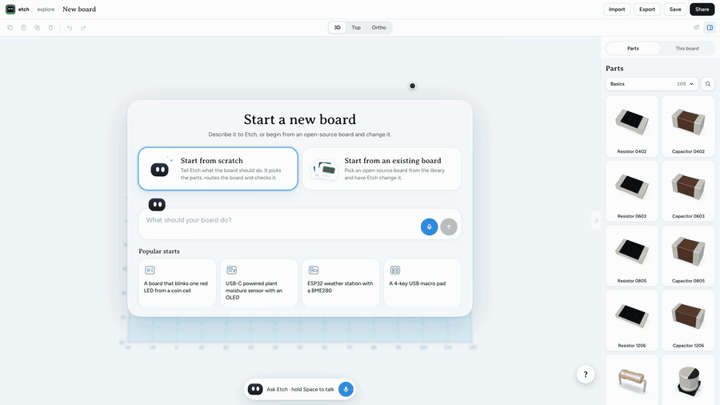
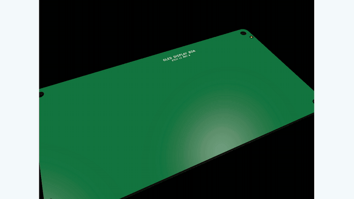
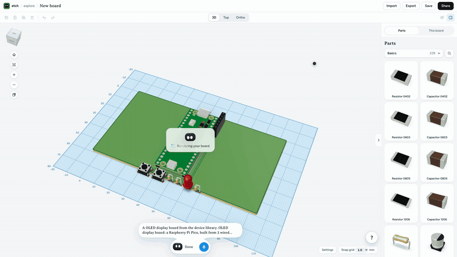
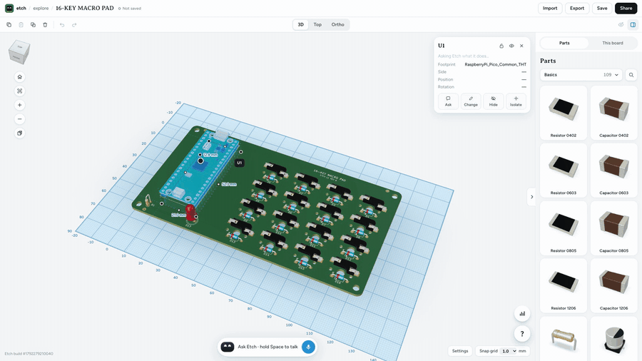
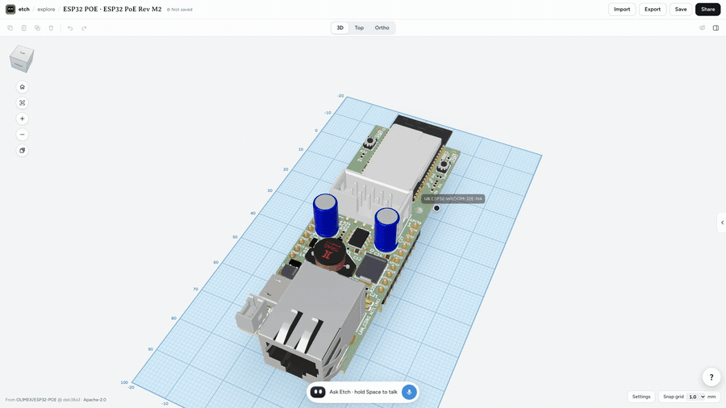
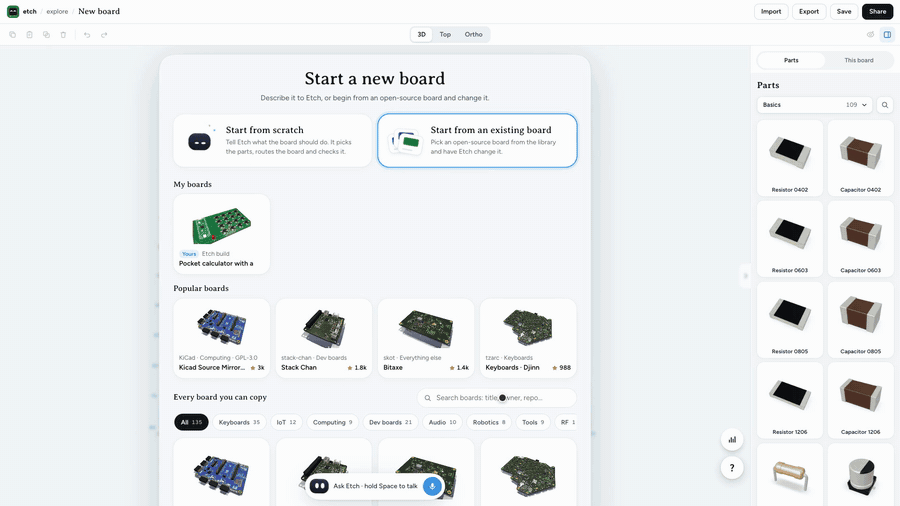
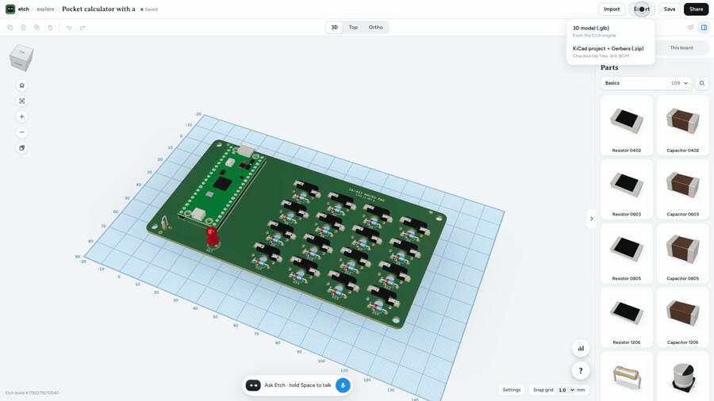
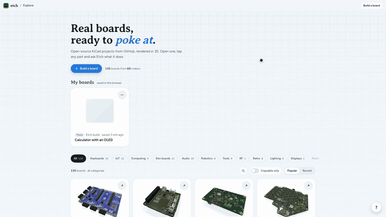
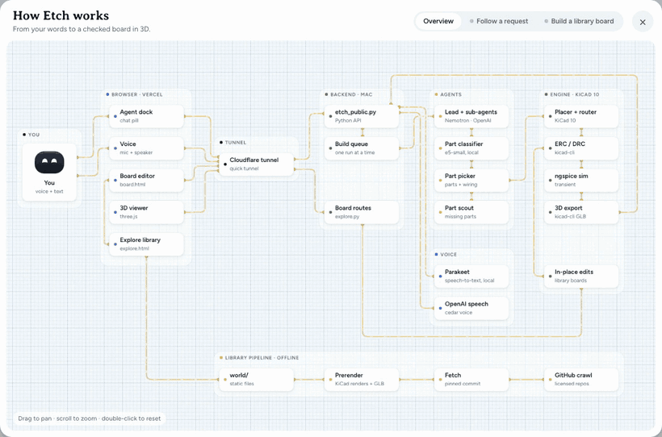

# Etch

**Claude Code for circuit boards.** Say the board you want. A team of agents picks real KiCad parts, places and routes the board, checks it, and hands you a board you can send to a fab, in 3D.

**Live:** https://etch.chat

<p align="center"></p>

## Quickstart

You can run all of Etch on your own laptop. On a Mac with Apple silicon:

```bash
git clone https://github.com/PranavAchar01/etch.git
cd etch
./setup.sh        # installs what's missing and creates .env
open -e .env      # paste one model key (see below)
./run.sh          # opens http://127.0.0.1:8766
```

You need one model key. The default is Crusoe Managed Inference running NVIDIA Nemotron (`CRUSOE_API_KEY`, from https://console.crusoecloud.com under Managed Inference, API keys). Any other OpenAI-compatible endpoint works too, including OpenAI itself or a local Ollama or vLLM server, which needs no key at all. `.env` lists every setting, where each key comes from and which ones are optional:

| Key | Needed? | What it turns on | Where to get it |
| --- | --- | --- | --- |
| `CRUSOE_API_KEY`, or `ETCH_BASE_URL` + `ETCH_API_KEY` | yes, one of them | the agents | https://console.crusoecloud.com, or your provider |
| `OPENAI_API_KEY` | optional | fallback model, Etch's spoken replies, the prompt rewriter | https://platform.openai.com/api-keys |
| `YOU_API_KEY` | optional | web search for parts that aren't in the KiCad libraries | https://you.com/platform |

`setup.sh` installs uv, ngspice, node, cloudflared and KiCad 10 with Homebrew if they're missing, builds the engine's Python env from the lockfile, fetches the open-source KiCad libraries at pinned commits (about 1.2 GB) and downloads the local speech-to-text model (about 500 MB). It's safe to run again. `./setup.sh --check` only reports what's there and what's missing.

`.env` is git-ignored. Real environment variables win over it, and on a Mac each key can live in the Keychain instead (the service names are in `.env`).

## Use etch.chat with your own backend

etch.chat is only the page. Every build runs on a backend, and the backend can be yours. Then your builds run on your machine with your keys, and the parts your agents fetch land in your copy of the parts library, ready to send back as a pull request.

1. Start Etch with a tunnel:

   ```bash
   ./run.sh --tunnel
   ```

   This opens a free Cloudflare quick tunnel (no account needed) and prints two things: your backend's public URL, like `https://something-random.trycloudflare.com`, and a link to etch.chat that already uses it.

2. Open etch.chat, click **Backend** at the top, paste the URL, press **Test**, then **Save**. The button changes to "Your backend". **Use official** switches back.

If Etch is already running, `scripts/tunnel.sh` starts only the tunnel. Plain `cloudflared tunnel --url http://localhost:3439` also works. Browsers can only call the backend from etch.chat, `etch*.vercel.app` and localhost pages. Running your own frontend somewhere else? Add its origin to `ETCH_ORIGINS` in `.env`.

### Your own stable URL

A quick tunnel gets a new URL every time it starts. For one that stays the same, use a named tunnel on a domain you have in Cloudflare (one-time setup):

```bash
cloudflared tunnel login                                  # pick your domain
cloudflared tunnel create etch
cloudflared tunnel route dns etch etch-api.yourdomain.com
```

Then set these two in `.env` and run `./run.sh --tunnel` as before:

```bash
ETCH_TUNNEL_NAME=etch
ETCH_TUNNEL_HOSTNAME=etch-api.yourdomain.com
```

Paste `https://etch-api.yourdomain.com` into Backend once. It stays saved in that browser.

### Contribute to the library

Parts your agents fetch (from LCSC/EasyEDA or from KiCad footprints published on GitHub) are saved in `engine/parts/cache/`, each with its source URL, licence and model checksum in `engine/parts/agent_index.json`. Etch never draws or models a part itself. A part needs a real published STEP model or it doesn't get used. To share parts, commit the new part folders with their index entries and open a pull request. Boards for the Explore library come from licensed GitHub repos through `library/`. Both are covered in [CONTRIBUTING.md](CONTRIBUTING.md).

## Linux and Windows

Run the backend in Docker (Windows through WSL 2 or Docker Desktop). The image has KiCad 10, ngspice and the engine:

```bash
cp .env.example .env      # add your key
docker compose up --build
curl http://127.0.0.1:3439/etch/health
```

Then follow [Use etch.chat with your own backend](#use-etchchat-with-your-own-backend), with `cloudflared tunnel --url http://localhost:3439` for the tunnel. Voice input isn't in the image, so you type instead. More detail in [docs/DEPLOY.md](docs/DEPLOY.md).

## Other model endpoints

Set these in `.env`:

```bash
# OpenAI
ETCH_BASE_URL=https://api.openai.com/v1
ETCH_API_KEY=sk-...
ETCH_MODEL=gpt-5-mini
ETCH_SUB_MODEL=gpt-5-nano

# Ollama on this machine (no key)
ETCH_BASE_URL=http://127.0.0.1:11434/v1
ETCH_MODEL=qwen3:32b
ETCH_SUB_MODEL=qwen3:8b
```

The model has to support tool calls. Small local models build simpler boards and fail more repairs. Inside Docker, reach a model server on your machine at `http://host.docker.internal:11434/v1` instead of 127.0.0.1.

## What you can do

<table>
<tr>
<td width="50%"><b>Build anything</b><br>One sentence in, a routed and checked KiCad board out. KiCad's own renders of the board as it's assembled:<br></td>
<td width="50%"><b>See it in 3D</b><br>Every part is its real 3D model. Orbit, zoom, flip it over.<br></td>
</tr>
<tr>
<td><b>Ask about any part</b><br>Click a part and ask what it does. Answers are pinned to the part.<br></td>
<td><b>Restyle it</b><br>Solder mask, silkscreen and finish change live.<br></td>
</tr>
<tr>
<td><b>Start from an open-source board</b><br>Pick any board from the library and change it.<br></td>
<td><b>Export real files</b><br>KiCad project, Gerbers, drill and BOM, checked again on export. Or the 3D model as GLB.<br></td>
</tr>
<tr>
<td colspan="2"><b>Explore 135 open-source boards</b><br>Real KiCad projects from GitHub, prerendered with every original 3D part model, each credited to its author and licence. Your own builds land in My boards.<br></td>
</tr>
</table>

## How it works

<p align="center"></p>

This is the "How Etch works" diagram from the **?** button in the app, playing its two tours: a request travelling from you to a checked 3D board, and a library board being built.

1. **You ask**, by voice or text. Speech-to-text runs locally (Parakeet).
2. **The agent team works it out.** A picker chooses parts, values and wiring, a part scout finds anything missing, and the lead tracks progress and decides when it's done.
3. **The KiCad 10 engine builds it.** Placement and routing, then the fab files and the 3D model.
4. **The agents check their own work.** Every try runs ERC, DRC, schematic-to-PCB parity, unconnected nets, routing, 3D models, an ngspice simulation and the benchmarks the agents wrote for the request. A failure goes back to the picker as a repair, up to three tries, then Etch stops and says why.
5. **You get the board** in 3D, ready to question, restyle, change or export.

### Built on

| | How Etch uses it |
| --- | --- |
| **Crusoe Managed Inference** | The default endpoint for every agent call (`api.inference.crusoecloud.com/v1`), paced to 28 requests a minute across all agents, with OpenAI as a fallback. |
| **NVIDIA Nemotron** | Nemotron 3 Super 120B picks parts and repairs failed designs; Nemotron 3.5 Lightning 30B scouts parts. Thinking is turned off for speed. |
| **You.com** | Searches for parts that aren't in the KiCad library, so the scout can turn them into real KiCad parts. |

## Architecture

```
 browser: etch.chat, or http://127.0.0.1:8766 from ./run.sh
    |   HTTPS (Cloudflare tunnel) or localhost
    v
 backend: deploy/etch_public.py, port 3439 ------> speech-to-text: studio/stt, port 3421
    |                                     \
    v                                      `----> model endpoint: Crusoe Nemotron, OpenAI, Ollama, vLLM
 agents: agent/
    lead, part picker, part scout ------------> You.com search, LCSC/EasyEDA, GitHub
    |                                           (fetched parts -> engine/parts/cache/)
    v
 engine: engine/, KiCad 10 + ngspice
    place, route, ERC, DRC, parity, simulation, 3D model, Gerbers
    |
    v
 engine/out/<run>/  ->  board, 3D GLB and fab files back to the browser
```

## Layout

| Path | What |
| --- | --- |
| `deploy/etch-app/` | The static site Vercel serves: the Explore library and homepage (`explore.html`, `/` rewrites to it), the board editor (`board.html`, `board.html?new=1` builds a new board from a description) and the UI kit demo (`kit.html`), with `js/` and `css/`. |
| `docs/media/` | The GIFs in this README, cut from recordings of the live site. |
| `deploy/etch-app/world/` | The prerendered open-source boards Explore shows (GLB, thumbnail, parts, credits per board). Built by `library/`. |
| `deploy/etch_public.py` | The backend API the page calls (port 3439). Routes and build events: [deploy/API.md](deploy/API.md). Board view routes are in `deploy/explore.py`. |
| `library/` | Finds licensed KiCad boards on GitHub and prerenders them into `deploy/etch-app/world/` ([library/README.md](library/README.md)). |
| `setup.sh`, `run.sh`, `.env.example` | Local install, start, and every setting with where its key comes from. |
| `scripts/tunnel.sh` | Cloudflare tunnel to your own backend (quick or named), for using it from etch.chat. |
| `Dockerfile`, `docker-compose.yml` | The backend on Linux or Windows. |
| `deploy/*.sh` | How the official backend runs on the maintainers' Mac: launchd restart, its tunnel, Vercel redeploy, STT keeper. |
| `agent/` | The lead agent and sub-agents that write and repair board specs ([agent/README.md](agent/README.md)). |
| `engine/` | Spec in, verified KiCad board out ([engine/README.md](engine/README.md)). |
| `engine/parts/` | Part index, KiCad catalog, classifier, pre-rendered part images and parts fetched from LCSC or GitHub (`cache/`). |
| `studio/kicad_frames.py` | Board render frames for the page. |
| `studio/stt/stt_server.cjs` | Local speech-to-text (Parakeet on sherpa-onnx, port 3421). |
| `vendor/espressif-kicad-libraries/` | ESP32 parts from Espressif's KiCad library 3.2.1 (CC-BY-SA 4.0, see its PROVENANCE.md). |

Build outputs (`engine/out/`) and the usage meter (`qa/`) are created at run time and are not in the repo.

## Deploying Explore (maintainers)

`deploy/redeploy.sh` uploads `deploy/etch-app/` as is, including `world/` (about 155 MB). Before running it:

1. Restart the backend so it loads `deploy/explore.py` (`deploy/restart.sh`), and check `/etch/health`.
2. Open `explore.html` and `board.html?id=gh:OLIMEX/ESP32-POE/HARDWARE/ESP32-PoE-hardware-revision-M2` against the local backend (`?api=http://127.0.0.1:3439`). Ask a question, pin a comment on a part and delete it.
3. `world/` holds GPL, CC-BY-SA and CERN-OHL-S boards. Each board page shows its author, repo, commit and licence; keep those visible.

To add or refresh boards: see [library/README.md](library/README.md), then commit `world/` and `library/manifest.json`.

## Settings

Every setting is in [.env.example](.env.example) with its default, and [docs/DEPLOY.md](docs/DEPLOY.md) has the full table. The ones most people touch are the model endpoint (`ETCH_BASE_URL`, `ETCH_MODEL`, `ETCH_SUB_MODEL`), the ports (`ETCH_PUBLIC_PORT`, `ETCH_PAGE_PORT`, `ETCH_STT_PORT`) and the build limits (`ETCH_MAX_RUNS`, `ETCH_RUNS_PER_IP_HOUR`, `ETCH_RUNS_PER_DAY`). `setup.sh` writes machine paths (`ETCH_KICAD_APP`, `ETCH_STT_HOME`, `ETCH_HEAVY_LOCK`) to `.etch.env`, which holds no secrets.

## Credits

Built by [Pranav Achar](https://github.com/PranavAchar01) and [Nithin](https://github.com/nithinaru). Etch won 1st overall at the Recursive Agents Hackathon in October 2026.

## License

MIT, see [LICENSE](LICENSE). The open-source boards in `deploy/etch-app/world/`, the vendored KiCad libraries and the fetched parts keep their own licences, listed in LICENSE and shown next to each board and part.
